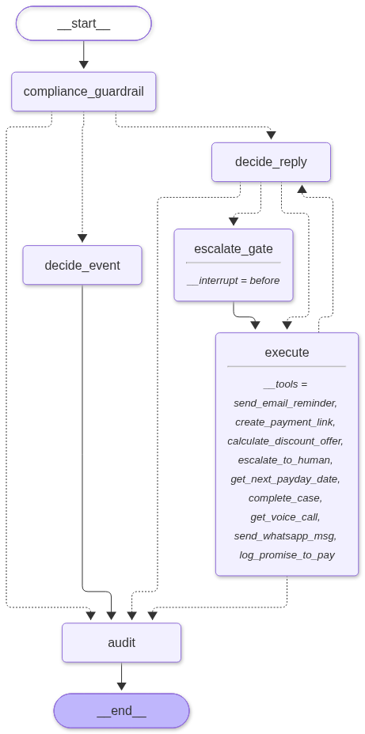

<div align="center">

# Renvue

### Autonomous revenue recovery for PayPal merchants

[](LICENSE)
[](https://python.org)
[](https://fastapi.tiangolo.com)
[](https://langchain-ai.github.io/langgraph/)
[](https://react.dev)
[](https://developer.paypal.com)

<p align="center">
  <b>Renvue</b> turns failed PayPal payments, halted subscriptions, abandoned checkouts, and overdue invoices into recovered revenue. A deterministic policy decides the next best action; PayPal APIs execute it; an LLM handles the customer conversation when one happens.
</p>

</div>

---

## The problem

Every merchant loses revenue to payments that fail for recoverable reasons: an expired card, a temporary insufficient-funds decline, an abandoned checkout, or an overdue invoice. Most dunning systems send the same reminder on the same schedule to every customer.

Renvue treats each failed payment as a case with its own history and picks one of nine recovery plays:

| Play | What it does |
| --- | --- |
| `no_contact` | Hold the case; do not contact the customer |
| `email_link` | Send a PayPal payment link by email |
| `sms_link` | Send a PayPal payment link by SMS/WhatsApp |
| `paypal_invoice_reminder` | Send a PayPal invoice reminder |
| `retry_now` | Retry the payment now |
| `retry_payday` | Schedule a retry around a payday signal |
| `update_method_link` | Send a PayPal link to update the payment method |
| `discount_link` | Offer a bounded concession with a payment link |
| `human_escalation` | Stop automation and hand the case to a human |

## How it works

```text
PayPal webhook
    -> case upsert
    -> feature snapshot
    -> policy score over eligible plays
    -> deterministic guardrails (veto power)
    -> execute exactly one play through PayPal
    -> observe outcome
    -> append-only decision / action / outcome logs
```

- **The policy decides.** Routine outbound decisions make zero LLM calls. The policy scores only plays that are already eligible for the case.
- **Guardrails hold veto power.** Max 3 touches, contact windows, discount bounds of 5–30%, a 7-day cumulative grace cap, dispute freeze, opt-out/STOP, currency and amount sanity, and a human-approval threshold are enforced in code and tests.
- **The LLM only communicates.** LangGraph + Mistral is invoked for inbound replies, negotiation, promise-to-pay extraction, and free-text responses, always inside guardrail bounds. It never chooses the action or generates training labels.
- **Every decision is auditable.** Decision, action, and outcome rows carry the feature snapshot hash, policy version, alternatives considered, and guardrail result.

<div align="center">
  <br/>
  
  <p><sub><em>Compiled LangGraph StateGraph showing pre-flight compliance guardrails, dual-path deterministic vs tool routing, and human-in-the-loop escalation gates.</em></sub></p>
  <br/>
</div>

## PayPal integration

The backend talks to the PayPal REST API directly (no vendor SDK):

- **OAuth 2.0** client-credentials token with a shared cache.
- **Orders v2** — create recovery orders, return `payer-action` links, capture approved orders.
- **Subscriptions v1** — read subscription state and create update-method links.
- **Invoicing v2** — create and remind on recovery invoices.
- **Disputes** — freeze dunning when a dispute is opened.
- **Webhooks** — verify `PAYPAL-TRANSMISSION-*` headers with `POST /v1/notifications/verify-webhook-signature`, then de-duplicate on `event.id`.
- **Buyer redirects** — `/api/paypal/return` captures approved orders and updates the matching case; `/api/paypal/cancel` confirms that no capture occurred.

Handled events include `PAYMENT.CAPTURE.COMPLETED`, `PAYMENT.CAPTURE.DENIED`, `PAYMENT.CAPTURE.PENDING`, `BILLING.SUBSCRIPTION.PAYMENT.FAILED`, `INVOICING.INVOICE.PAID`, `CUSTOMER.DISPUTE.CREATED`, and related lifecycle events. Unknown events are acknowledged and ignored.

## Stack

| Layer | Technology |
| --- | --- |
| API | FastAPI, Pydantic |
| Persistence | PostgreSQL, SQLModel, append-only audit tables |
| Agent | LangGraph, LangChain, Mistral (or Gemini / Groq) |
| Background jobs | Taskiq, Redis / Valkey |
| Realtime | Redis pub/sub, Server-Sent Events |
| Dashboard | React 19, Vite, Tailwind CSS v4 |
| Data grid | AG Grid Community v36 (Quartz Graphite, virtualized, multi-sort, CSV export) |
| Charts | AG Charts Community v14 (Tree-shaken bar, donut, multi-touch velocity & ROI analytics) |
| Deployment | Render Blueprint (`render.yaml` isolated Web + Worker architecture) |
| Payments | PayPal REST APIs (Orders v2, Subscriptions v1, Invoicing v2, Disputes) |

## Repository layout

```text
renvue/
├── agent_workflowv2.png               # Compiled LangGraph StateGraph visual
├── render.yaml                        # Render Infrastructure as Code Blueprint
├── docker-compose.yml                 # Local PostgreSQL + Redis
├── Dockerfile                         # Unified multi-process container (supervisord)
├── start-tmux.sh                      # 4-quadrant tmux development launcher
├── backend/
│   ├── pyproject.toml
│   ├── Dockerfile                     # Production-ready slim backend container
│   ├── .env.example
│   ├── scripts/
│   │   ├── paypal_proof.py            # $10 sandbox order / capture proof
│   │   ├── seed_diverse_cases.py      # Seeds 34 diverse recovery cases
│   │   └── start-worker.sh            # Taskiq worker & scheduler entrypoint
│   └── src/
│       ├── agent/                     # LangGraph graph, nodes, prompts, tools
│       ├── background/                # Taskiq worker and scheduler
│       ├── config/                    # settings, DB, clients
│       ├── data/generate.py           # synthetic demo data
│       ├── ml/                        # empirical Bayes, runtime scoring, nightly retrain
│       ├── models/                    # SQLModel tables and tool schemas
│       ├── paypal/                    # auth, orders, subscriptions, invoicing, disputes, webhooks
│       ├── policy/                    # locked Play/Observation/Action/Outcome contracts
│       ├── router/                    # PayPal webhooks, inbound replies, API, simulator, learning
│       ├── service/                   # event loop, guardrails, decisions, money
│       └── tests/                     # eight regression suites
├── frontend/                          # React operations dashboard
│   ├── src/components/CaseGrid.tsx    # AG Grid Community v36 implementation
│   ├── src/components/VizStudio.tsx   # AG Charts Community v14 analytics studio
│   └── src/components/AgentLab.tsx    # Policy simulator & empirical Bayes panel
└── LICENSE
```

## Quick start

### Quick Start (Recommended: Single Docker Compose)

Run the entire application (PostgreSQL, Redis, FastAPI Backend, Taskiq Worker, Taskiq Scheduler, and React Frontend) with one command:

```bash
# 1. Copy the example environment file and add your credentials
cp .env.example .env

# 2. Start all services
docker compose up --build

# 3. (Optional) Seed realistic demo recovery cases into the database
docker compose exec backend uv run python scripts/seed_diverse_cases.py
```

- **Frontend UI**: [http://localhost:5173](http://localhost:5173)
- **Backend API & Swagger Docs**: [http://localhost:8000/docs](http://localhost:8000/docs)
- **Health Check**: [http://localhost:8000/health](http://localhost:8000/health)

All service-to-service connections (Database, Redis, API URLs) are pre-configured in `docker-compose.yml`. You only need to supply your PayPal Sandbox credentials and an LLM key in `.env`.

---

### Alternative: Local Development Setup

If you prefer running services directly on your host machine without containerizing the frontend and backend:

### Prerequisites

- Python 3.12+ and [uv](https://docs.astral.sh/uv/)
- Node.js 20.19+ or 22.12+ and `npm` (required by Vite 8)
- Docker (for local PostgreSQL and Redis)
- A PayPal sandbox REST app from [developer.paypal.com](https://developer.paypal.com/dashboard/applications/sandbox)
- An LLM API key (free tiers available) if you want to exercise the conversational replies

### 1. Start infrastructure (Postgres & Redis only)

```bash
docker compose up -d postgres redis
```

### 2. Configure the backend

```bash
cp backend/.env.example backend/.env
```

Fill in `PAYPAL_CLIENT_ID` and `PAYPAL_CLIENT_SECRET` from the sandbox app. Keep `PAYPAL_API_BASE=https://api-m.sandbox.paypal.com` for sandbox work. Real credentials belong only in `backend/.env`, which is gitignored.

The conversational AI path needs an LLM key. `.env.example` defaults to `LLM_PROVIDER=groq`, so set `GROQ_API_KEY` (a free Groq key is enough). To use another provider, set `LLM_PROVIDER` to `groq`, `gemini`, `mistral`, `openrouter`, `ollama`, or `huggingface` and fill the matching key. Without an LLM key the API still starts and the deterministic dashboard/simulator work, but inbound AI replies are disabled; the startup log prints a warning.

`DEMO_MODE=false` (the default in `.env.example`) calls the PayPal sandbox. Set it to `true` only for an offline demo: PayPal links and outbound email/WhatsApp are mocked, and the case drawer labels the link as a mock.

Outbound delivery is reported honestly per audit entry: `delivery_status` is `sent`, `captured`, or `failed`. `captured` means a sandbox/test double accepted the message because no provider credentials were configured (or `DEMO_MODE=true`); it does **not** mean the customer received it. Failed sends are recorded as `outreach_failed` and the executor falls back to the other real channel.

### 3. Install and run

```bash
cd backend
uv sync

# Optional: load 34 demo recovery cases so the dashboard is not empty
# (this clears any existing cases in the configured database)
uv run python scripts/seed_diverse_cases.py

# Terminal 1 — API
uv run uvicorn src.main:app --reload --port 8000

# Terminal 2 — worker
uv run taskiq worker -d src background.worker:broker

# Terminal 3 — scheduler
uv run taskiq scheduler -d src background.worker:scheduler
```

### 4. Start the dashboard

```bash
cd frontend
npm install
npm run dev
```

Open `http://localhost:5173`. The dashboard defaults to `http://localhost:8000/api`; if the API runs elsewhere, set `VITE_API_URL` (for example `http://localhost:8001/api`) before starting Vite.

If you have a local `frontend/.env.local`, it overrides that default. Make sure its `VITE_API_URL` uses the same port as the backend, or delete the file to use the default. Restart Vite after changing it.

### Alternative: One-command tmux development environment

After steps 1–2 and the dependency installs from steps 3–4, launch the full system (FastAPI backend, Vite frontend, Taskiq worker, Taskiq scheduler) tiled in a single 2x2 tmux session:

```bash
./start-tmux.sh
```

The launcher requires `tmux`, `uv`, `npm`, and (unless PostgreSQL and Redis are already running) Docker.

- Mouse scrolling and clicking work across all 4 quadrants.
- `Ctrl+b` then `d` to detach (all background services keep running).
- `./start-tmux.sh stop` terminates all 4 processes cleanly.

### 5. Expose the webhook

PayPal requires a public HTTPS endpoint. Tunnel the API and register the URL in **Apps & Credentials → Webhooks**:

```bash
ngrok http 8000
# Webhook URL: https://<tunnel>/webhooks/paypal
```

Set `PAYPAL_WEBHOOK_ID` (or comma-separated `PAYPAL_WEBHOOK_IDS`) in `backend/.env` so signature verification can use the registered webhook.

## PayPal sandbox proof

The proof script creates a $10.00 USD order, prints the buyer approval URL, and captures the order after approval.

```bash
cd backend
uv run python scripts/paypal_proof.py
```

Open the printed `checkoutnow?token=...` URL with a **separate PayPal sandbox personal buyer account** and approve the payment. PayPal redirects to `/api/paypal/return`, which captures the approved order automatically. Record the capture evidence with:

```bash
uv run python scripts/paypal_proof.py --capture <ORDER_ID>
```

The script writes local evidence to `backend/data/paypal_proof.json` (gitignored) and refuses non-sandbox hosts unless `--allow-live` is passed. It never prints or stores the client secret or OAuth token.

The return URL must point at the Renvue backend. If another app owns that port, set `BACKEND_URL` to the Renvue port and restart the backend before creating the order.

Verified sandbox capture (2026-10-31): order `79239162G4187994B` → capture `52M84231CC782152A`, status `COMPLETED`, `$10.00 USD`.

Verified sandbox recovery (2026-11-01):

- Simulated failed payment → case `failed_1793526831_992` ($125.00 USD)
- Policy `rules-v0` → `retry_payday`; guardrails passed
- PayPal order `43F2483513474512X` → buyer approval → capture `1TY06259TY549621D`, status `COMPLETED`
- Case marked `recovered`; dashboard recovered total `$125.00 USD`
- Signed `CHECKOUT.ORDER.APPROVED` and `PAYMENT.CAPTURE.COMPLETED` webhooks verified against the registered webhook and de-duplicated

The failure event was seeded by the demo simulator. The order, buyer approval, capture, and webhooks are real PayPal sandbox activity.

## Online learning & empirical Bayes loop

Renvue closes the feedback loop between real payment outcomes and future outreach decisions without risky live exploration:

- **Empirical Bayes updates:** The recovery policy blends an offline-trained LightGBM model prior with play-level Beta-Bernoulli empirical Bayes updates from observed attempt outcomes ($w = \frac{n}{n + s}$). When learning updates rates, decisions are tagged with `+eb`.
- **Offline model vs online updates:** The LightGBM tree weights remain frozen offline; online learning continuously updates observational play response rates.
- **Strict provenance separation:** Live outcomes from production webhooks (`provenance="live"`) are never mixed with simulated cases or sandbox experiments (`provenance="sandbox"`).
- **Delivery verification:** A failed email or WhatsApp delivery is an operational failure, not customer silence. Only attempts with verified delivery (`sent` or `captured`) can ever produce an `unresponsive_timeout` non-response learning sample.
- **Safety gates & retraining:** Nightly retraining is real, wired via Taskiq, and strictly gated behind 5 thresholds (100 samples, 20 recoveries, 3 eligible plays, 7 days, 5 samples/play). Auto-promotion is disabled by default (`RETRAIN_ENABLED=false`).
- **Honest metrics:** The measured ML-vs-rules difference on the calibrated simulator is $6.75 per 1,000 cases with a 95% CI of `[-$877.52, +$979.73]`. We do not claim causal lift.

## Tests

Eight regression suites cover the lifecycle, promise-to-pay, B2B invoices, subscriptions, checkout concessions, webhook security, ML policy / Agent Lab API, and empirical Bayes learning with retrain safety gates:

```bash
cd backend
PYTHONPATH=src uv run python src/tests/runner.py
```

The suite exercises PayPal OAuth and order creation, so run it with valid sandbox credentials and `DEMO_MODE=false` (the `.env.example` default). With placeholder credentials or an offline demo configuration, the checkout-concession suite fails at the mocked PayPal link step.

Run one suite directly, for example:

```bash
cd backend
PYTHONPATH=src uv run python src/tests/test_learning.py
```

Frontend production build:

```bash
cd frontend
npm run build
```

## AG Grid & AG Charts Unified Visualization Suite

Renvue integrates **AG Grid Community v36** and **AG Charts Community v14** (`ag-charts-react`) to deliver an enterprise-grade analytics and queue management experience designed for high-velocity revenue recovery operations.

### 1. AG Charts Visualization Studio (`VizStudio.tsx`)
The analytics view (`/#analytics`) renders real-time business telemetry powered by AG Charts:
- **Tree-Shaken Module Architecture**: Uses `ModuleRegistry.registerModules([BarSeriesModule, DonutSeriesModule, CategoryAxisModule, NumberAxisModule])` to eliminate unused chart overhead, keeping client bundle load instantaneous.
- **Custom Graphite Dark Theme**: Built on `ag-default-dark` with custom-tokenized palettes (`#4cc38a` emerald recovered, `#f59e0b` amber active pipeline, `#3b82f6` blue touch engagement, `#06b6d4` cyan win-rates), transparent card backgrounds, and Geist Variable typography.
- **Four Coordinated Executive Visualizations**:
  1. **Outreach Channel ROI (Horizontal Grouped Bar)**: Tracks recovered revenue versus active pipeline capital across outreach plays (`Email Link`, `WhatsApp`, `Fastlane Checkout`, `Payday Retry`, `Invoice Reminder`). Uses currency tick formatters and contrast grid styling.
  2. **5-Segment Root Cause Donut**: An interactive donut chart (`innerRadiusRatio: 0.68`) with custom HTML tooltip renderers highlighting capital concentration across five primary decline categories (*Card Expired / Mandate*, *Insufficient Funds*, *Invoice Overdue*, *Checkout Abandoned*, and *Risk/Velocity Flags*).
  3. **Touch Cadence Velocity (Vertical Grouped Bar)**: Compares cases engaged versus cases recovered across 1st, 2nd, and 3rd touches, visually diagnosing where customer response drop-off occurs.
  4. **Amount Tier Win Rates (Horizontal Bar)**: Displays win-rate recovery percentages across transaction bands (*Micro < $100*, *Mid $100–$1k*, *High $1k–$5k*, *Enterprise > $5k*).
- **Dynamic Real-Time Recomputation**: All charts recalculate reactively using `useMemo` hooks as recovery cases stream into the dashboard via Server-Sent Events (SSE).

### 2. AG Grid Operations Console (`CaseGrid.tsx`)
The primary case queue across the Overview and Cases (`/#cases`) views uses AG Grid Community:
- **Quartz Graphite Theme**: Tokenized dark styling (`#19191b` card body, `#141415` headers, `#ededed` text, 14px horizontal cell padding, and subtle hairline borders) matching the Renvue visual aesthetic without browser-native popup artifacts.
- **Multi-Dimensional Semantic Filtering**: Custom Graphite popover menus provide instant client-side filtering without page reloads:
  - *Status Tabs*: Active, Escalated, Recovered, and Closed queues with live count badges.
  - *Categorical*: Failure type and outreach channel.
  - *Monetary*: Tiered balance brackets (Micro, Mid, High, Enterprise).
  - *Ordinal*: Touch attempt progression with visual status indicators (`●○○`, `●●○`, `●●●`).
  - *Universal Search*: Instant substring filtering across customer names, emails, and PayPal case IDs.
- **Custom Cell Renderers**: Customer avatar cards, recovery status pills, touch attempt pips, and channel badges.
- **High-Performance Operations**: Virtualized DOM rendering, single-click column sorting (`suppressHeaderMenuButton: true`), and instant CSV exports via `gridApi.exportDataAsCsv()`.
- **Code-Split Streaming**: Loaded via `React.lazy` and `Suspense` so the initial application shell loads immediately (440 kB) while the data grid streams in asynchronously.

---

## PayPal Developer Platform Deep Integration

Renvue is architected around PayPal's v1 and v2 REST developer APIs, handling the full lifecycle of payment failures, automated retries, and customer reconciliation.

```
       PayPal Sandbox Webhooks               PayPal REST APIs
  (Events & Signature Verification)   (Orders v2, Subscriptions, Invoices)
                │                                    ▲
                ▼                                    │
    ┌──────────────────────┐              ┌──────────────────────┐
    │  Cryptographic HMAC  │              │  One-Time Recovery   │
    │ Signature Validation │              │ Order / Capture / QR │
    └──────────┬───────────┘              └──────────▲───────────┘
               │                                     │
               ▼                                     │
    ┌──────────────────────┐              ┌──────────┴───────────┐
    │ Deduplication Engine │              │ Taskiq Async Worker  │
    │  (Postgres & Redis)  │ ───────────► │  & Playbook Executor │
    └──────────────────────┘              └──────────────────────┘
```

### 1. Cryptographic Webhook Verification (`backend/src/paypal/webhooks.py`)
- Ingests incoming PayPal webhook events with zero trust.
- Validates PayPal certificate transmission headers (`paypal-auth-algo`, `paypal-cert-url`, `paypal-transmission-id`, `paypal-transmission-sig`, `paypal-transmission-time`) by posting the unmutated raw byte payload to `/v1/notifications/verify-webhook-signature`.
- Deduplicates event deliveries using unique database constraints on `event.id`, preventing duplicate processing loops.

### 2. Event Normalization & Ingestion (`backend/src/paypal/events.py`)
Maps incoming PayPal webhook payloads into unified `RecoveryState` models:
- **`PAYMENT.CAPTURE.DENIED` / `PAYMENT.CAPTURE.PENDING`**: Classifies card declines, insufficient funds, and network rejections.
- **`BILLING.SUBSCRIPTION.PAYMENT.FAILED` / `BILLING.SUBSCRIPTION.SUSPENDED`**: Detects recurring payment lapses and suspended customer billing agreements.
- **`INVOICING.INVOICE.UPDATED`**: Identifies B2B invoices that transitioned past their due date without payment.
- **`CHECKOUT.ORDER.CREATED`**: Monitors order creation and initializes an asynchronous abandoned cart recovery timer.

### 3. Orders v2 API & Dynamic Concessions (`backend/src/paypal/orders.py`)
- **Instant One-Time Checkout URLs**: Invokes `POST /v2/checkout/orders` with `intent: CAPTURE`, binding the case ID to `custom_id` and `reference_id`.
- **Dynamic AI Concessions**: When the policy or conversational agent awards a concession (e.g., a 10% retention discount), the updated discounted amount is baked directly into the PayPal purchase unit so the customer completes payment through a clean, authentic PayPal checkout experience.
- **Idempotent Order Capture**: Captures approved payments via `POST /v2/checkout/orders/{id}/capture`, automatically marking the recovery case as `recovered` and recording recovered revenue.

### 4. Invoicing v2 API (`backend/src/paypal/invoicing.py`)
- Creates and sends draft invoices via `POST /v2/invoicing/invoices` and `POST /v2/invoicing/invoices/{id}/send`.
- Generates embeddable PayPal QR codes for invoices via `POST /v2/invoicing/invoices/{id}/generate-qr-code`.
- Issues automated invoice reminders using `POST /v2/invoicing/invoices/{id}/remind`.

### 5. Subscriptions v1 API (`backend/src/paypal/subscriptions.py`)
- Retrieves agreement details and failed billing cycles from `GET /v1/billing/subscriptions/{id}`.
- Re-engages subscribers with direct update-payment-method links and reactivates stalled recurring revenue.

### 6. Abandoned Cart Recovery Timer (`backend/src/background/worker.py`)
- When a `CHECKOUT.ORDER.CREATED` event occurs, Taskiq schedules a 15-minute background evaluation timer.
- The worker verifies the order status via `GET /v2/checkout/orders/{id}`. If the order remains uncompleted, Renvue automatically generates a Fastlane re-engagement link and contacts the buyer before drop-off is permanent.

---

## AI Agent & Machine Learning Architecture

Renvue pairs an autonomous **LangGraph StateGraph** agent with an empirical **Machine Learning Policy Engine** to resolve cases with high win rates while strictly safeguarding merchant margins.

```
                         Incoming Event / Customer Reply
                                        │
                                        ▼
                         ┌─────────────────────────────┐
                         │ Pre-Flight Compliance Gate  │
                         │   (TCPA 9am-9pm Window)     │
                         └──────────────┬──────────────┘
                                        │
                      ┌─────────────────┴─────────────────┐
                      │                                   │
             [Webhook / Timer]                  [Customer Reply Inbound]
                      ▼                                   ▼
          ┌───────────────────────┐           ┌───────────────────────┐
          │   Deterministic ML    │           │ Conversational Agent  │
          │     Play Selector     │           │  (LLM + Tool Calling) │
          └───────────┬───────────┘           └───────────┬───────────┘
                      │                                   │
                      │                        [Concession > 30%?]
                      │                       ┌───────────┴───────────┐
                      │                       │                       │
                      │                     (Yes)                    (No)
                      │                       ▼                       │
                      │           ┌───────────────────────┐           │
                      │           │ Human-in-the-Loop Gate│           │
                      │           │ (LangGraph Interrupt) │           │
                      │           └───────────┬───────────┘           │
                      │                       │ (Merchant Approved)   │
                      ▼                       ▼                       ▼
          ┌───────────────────────────────────────────────────────────┐
          │                    Execution & Audit                      │
          │         (PayPal API Calls + Redis Broadcast SSE)          │
          └───────────────────────────────────────────────────────────┘
```

### 1. StateGraph Orchestration (`backend/src/agent/graph.py`)
- **Stateful Persistence**: Compiled with LangGraph's PostgreSQL checkpointer (`AsyncPostgresSaver`) to preserve conversation thread memory across days of customer dialogue.
- **Pre-Flight Compliance Guardrail (`compliance_guardrail`)**: Enforces TCPA and CAN-SPAM regulations before any outreach is initiated. Validates the customer's local contact window (9:00 AM – 9:00 PM), checks cooling-off periods, and suppresses abusive contacts.
- **Dual-Path Architecture**:
  - **Fast-Path Engine (`decide_event`)**: Sub-10ms deterministic routing for inbound webhooks and scheduled retries, selecting the optimal recovery play instantly.
  - **Conversational Engine (`decide_reply`)**: Routes customer responses (email, WhatsApp, SMS) to an LLM reasoning node equipped with structured tool-calling.

### 2. Multi-Model LLM Support (`backend/src/agent/utils.py`)
Supports hot-swapping between frontier and open-weight models via environment configuration:
- **Groq** (`llama-3.3-70b-versatile`): Ultra-low latency conversational responses (< 400ms).
- **Google Gemini** (`gemini-1.5-flash` / `gemini-3.8-flash`): High context awareness for complex dispute resolution.
- **Mistral AI** (`mistral-small-latest`): Robust multilingual customer support.
- **OpenRouter** / **Ollama**: Self-hosted local inference without cloud vendor lock-in.

### 3. Agent Tool Calling Suite (`backend/src/agent/tools.py`)
The LLM selects and executes tools based on customer intent:
- `send_email_reminder`: Dispatches dynamic, tone-adaptive email copy with embedded PayPal approval links.
- `offer_discount_concession`: Calculates and offers dynamic retention discounts bounded by merchant policy.
- `schedule_salary_date_retry`: Uses date-parsing NLP to extract promised paydays from customer replies (e.g., *"I get paid next Friday"*) and schedules a precision Taskiq retry.
- `escalate_case`: Routes high-friction accounts or explicit requests for human assistance to staff.
- `complete_case`: Closes cases upon payment verification.

### 4. Human-in-the-Loop Breakpoints (`escalate_gate`)
- Graph compiled with `interrupt_before=["escalate_gate"]`.
- If an agent proposes a concession exceeding the configured maximum (`MAX_DISCOUNT_ALLOWED`, default 30%) or detects high fraud risk, execution pauses and checkpoints to PostgreSQL.
- The merchant receives an alert in the dashboard with an **Approve / Reject** button. Upon approval, the agent resumes execution from the exact checkpoint and issues the PayPal recovery link.

### 5. Online Bayesian Learning & Offline LightGBM Policy (`backend/src/ml/`)
- **Online Empirical Bayes (Thompson Sampling)**: Tracks observed recovery rates for each play across customer segments. Updates Beta distribution priors in real-time (`learning.py`), dynamically shifting traffic toward the highest-yield playbooks without manual tuning.
- **Offline LightGBM Policy Engine**: Analyzes 14 engineered transaction and behavioral features (balance size, past payment count, decline code category, customer tenure) to predict the probability of recovery net of concession cost.
- **Automated Retraining Loop**: Scheduled nightly Taskiq job that retrains the policy model on accumulated outcomes with automated candidate gating (requires sample threshold validation before promotion).

---

## Demo simulator

The dashboard includes a PayPal-shaped event simulator for local demos. It is a test rig, not evidence about real merchants. Every simulated case is labeled as simulated in the UI and logs.

The API also exposes `/fake-event` and `/fake-action` for scripted demo runs.

## Security notes

- Secrets are read from `backend/.env` only; `.env.example` contains placeholders.
- Webhook deliveries are verified with PayPal's signature API before they are processed.
- Webhook events are de-duplicated on `event.id`, and processing failures are logged without causing PayPal retry loops.
- `.opencode/`, `opencode.json`, logs, local databases, and generated proof files are gitignored.

## License

MIT — see [LICENSE](LICENSE).
